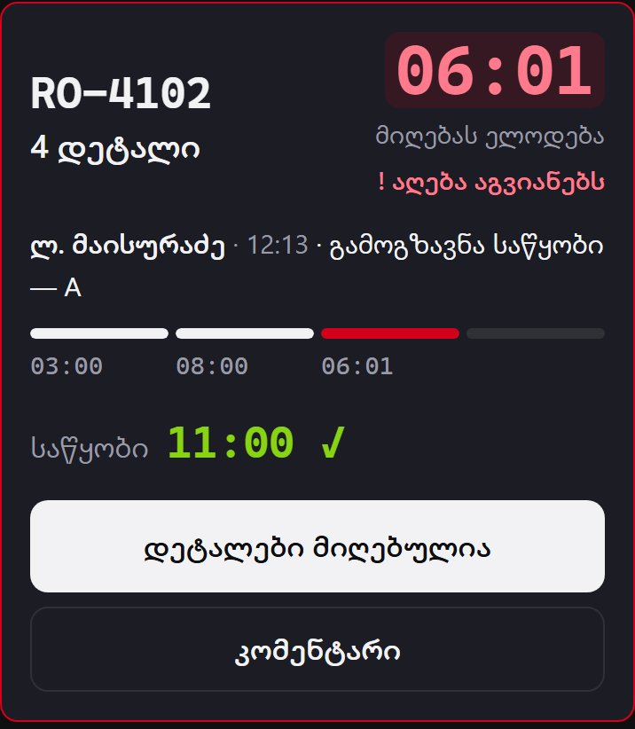
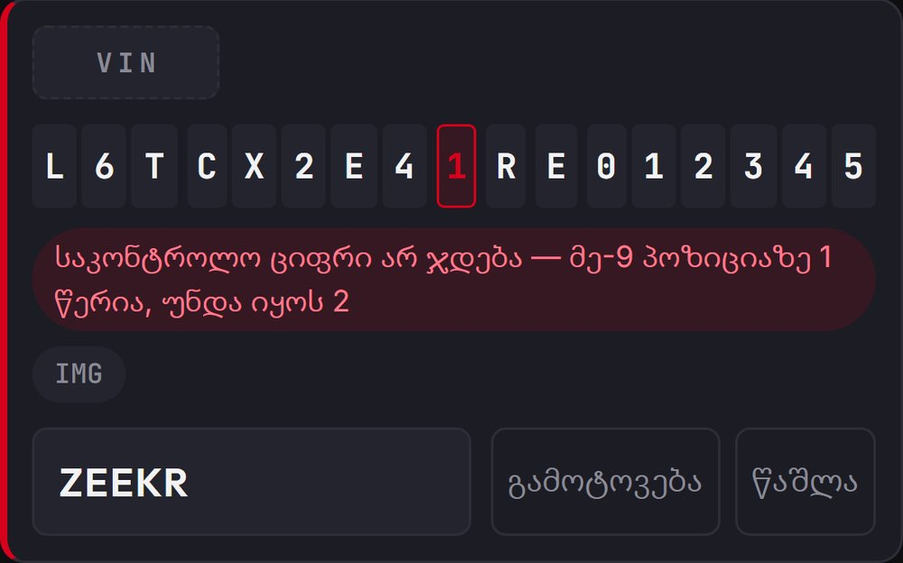
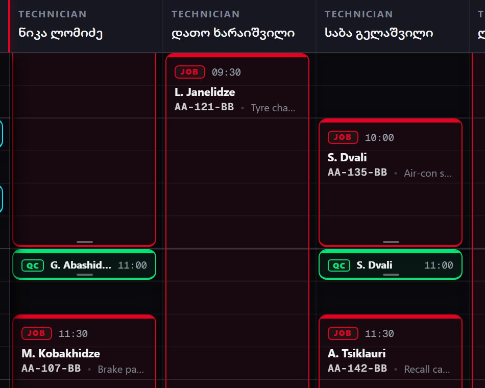
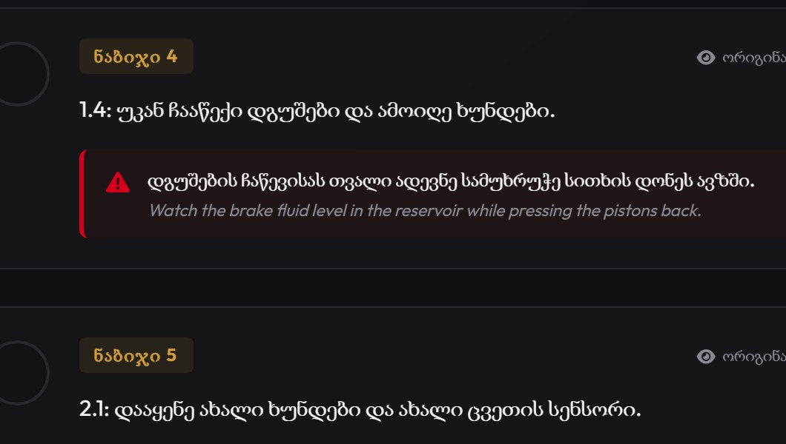

### Givi Jananashvili

**Product owner & developer** — I build the internal tools a premium automotive service centre runs on: small, measured, and designed with the people who use them every day.

The four projects below are private, because they are internal tools built for my employer. Each one has a short deck with real screens (made-up names, sample data), and I'm happy to walk through the code live.

<table>
<tr>
<td width="360" valign="top"></td>
<td valign="top">

#### Parts Cycle · in daily use
Times every parts request from the warehouse to the workshop, fairly enough that management could set a target on it.

- The KPI is set on 9 requests in 10, not the average: a few stuck orders skew the average.
- Clocks count working time only. The rules were agreed with the people being measured.
- 11 staff users on their phones, 2 channels, 210 automated tests.

Python · FastAPI · PostgreSQL · installable web app · Web Push · Cloud Run

**Deck:** [English](decks/parts-cycle.pdf) · [ქართული](decks/parts-cycle-ka.pdf)

</td>
</tr>
<tr>
<td width="360" valign="top"></td>
<td valign="top">

#### Wash Log · in daily use
A phone photo of the windscreen becomes a checked row in the spreadsheet management already reads.

- An audit of the old hand-typed log found 60 impossible VINs in 1,757 rows.
- The check-digit rule is learned from the data, per manufacturer. Applying the standard everywhere would have rejected a whole brand.
- Local OCR, no paid API; the spreadsheet stays the source of truth.

Python · FastAPI · RapidOCR (ONNX) · openpyxl · Cloud Run

**Deck:** [English](decks/wash-log.pdf) · [ქართული](decks/wash-log-ka.pdf)

</td>
</tr>
<tr>
<td width="360" valign="top"></td>
<td valign="top">

#### Service Planner · reference build
The workshop day on one board, from reception to handover.

- The server refuses to release a car before quality control has signed it off.
- 5 brands, 5 roles checked on every write, 63 automated tests.
- A vendor rebuilt the company's main planner from this code and my specification. I then audited their build: 40 findings, 4 of them blocking.

Python · FastAPI · PostgreSQL · React · Vite · Realtime

**Deck:** [English](decks/service-planner.pdf) · [ქართული](decks/service-planner-ka.pdf)

</td>
</tr>
<tr>
<td width="360" valign="top"></td>
<td valign="top">

#### Repair Reader · prototype
A manufacturer's repair manual goes in; a Georgian work card with steps, parts and tools comes out.

- The model fills a fixed form with 10 required fields instead of writing free text.
- A glossary of 2,106 terms, workshop slang included.
- Every translated line keeps the original English under it, so a technician can always check the source.

Python · FastAPI · Gemini structured output · PyMuPDF

**Deck:** [English](decks/repair-reader.pdf) · [ქართული](decks/repair-reader-ka.pdf)

</td>
</tr>
</table>

**Contact:** [givijananashvili40@gmail.com](mailto:givijananashvili40@gmail.com) · [LinkedIn](https://www.linkedin.com/in/givi-jananashvili-a9877026b/)
